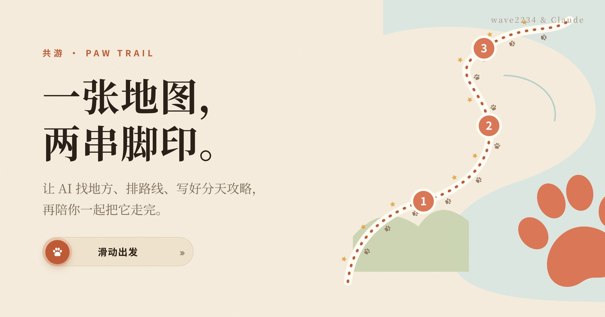
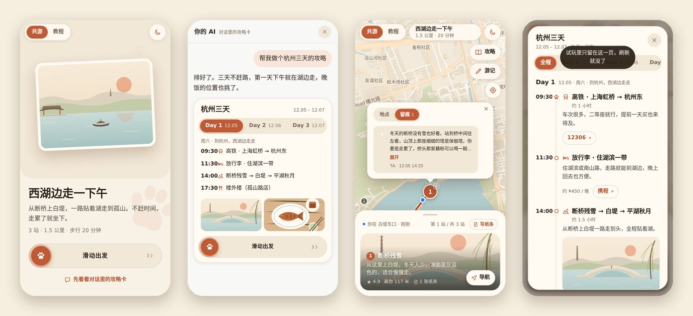
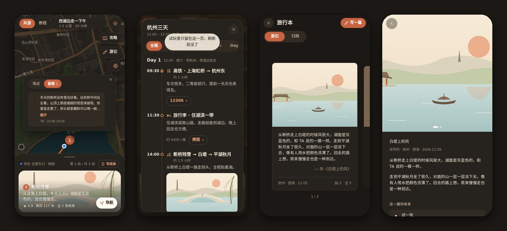

# 共游 · Paw Trail

> 一张地图，两串脚印。让你的 AI 找地方、排路线、写好分天攻略，再陪你一起把它走完。



**[在线试玩 →](https://wave2234.github.io/paw-trail/)**

试玩是纯前端，示例数据都是编的（杭州西湖），手机打开最顺手；右上角可以切白天 / 黑夜，封面上能先看一眼「对话里的攻略卡」。




文中「你」是你自己，「你的 AI」「TA」是陪你出门的那位。例子里的地点是真的，行程、纸条和游记全是编的。

---

## 目录

1. [它能做什么](#一它能做什么)
2. [整体结构和要准备的东西](#二整体结构和要准备的东西)
3. [给 AI 的工具](#三给-ai-的工具)
4. [找地方：国内高德，国外 Google](#四找地方国内高德国外-google)
5. [排路线](#五排路线)
6. [分天攻略](#六分天攻略)
7. [聊天里的攻略卡](#七聊天里的攻略卡)
8. [地图页](#八地图页)
9. [纸条：你和 AI 都能留](#九纸条你和-ai-都能留)
10. [游记和归档](#十游记和归档)
11. [踩过的坑](#十一踩过的坑)
12. [给你的 AI 看的一段话](#十二给你的-ai-看的一段话)
13. [文件](#十三文件)
14. [致谢](#十四致谢)

---

## 一、它能做什么

- **找地方、排一条线**：你说「下午想在西湖边走走」，AI 以你的位置为中心搜附近的景点、咖啡、书店、展览（国内走高德，国外走 Google），挑两到五站，排成一条真实的步行 / 骑行 / 公交路线，顺手写一页小攻略。
- **分天攻略**：多天、跨城、出国的行程，AI 按天写成结构化的攻略：几点、做什么、多久、花多少，附 12306、携程、景点官网、Airbnb 这类能直接点开的链接。景点、饭店、住处没给图的，后端会按名字自动补一张。
- **聊天里的攻略卡**：攻略一存好，聊天里那条回复下面就长出一张卡：顶上按 Day 切换，中间是时间轴，下面几张图，最底下一条「滑动出发」，一滑就进地图。
- **地图页**：出发封面 → 暖色矢量地图 → 点站点出一个钉在点上方的气泡（地点 / 留痕两栏）→ 底部抽屉看全程 → 「攻略」里是带虚线时间轴的分天攻略。
- **纸条**：你和 AI 都能在走过的地方留一句话、一张图。AI 留不留，看你的位置和你说的话，由它自己判断。
- **游记和归档**：上图下文、左右滑的游记卡，你和 AI 都能写；归档里能翻每一次排过的线和攻略，走完的线还能在地图上回看。

---

## 二、整体结构和要准备的东西

```
你 ──聊天──▶ 你的 AI ──调工具 trail(action=…)──▶ 你的后端
                                               ├─ 高德 / Google：搜地方、算路线、按名字补图
                                               ├─ trails.json        线（站点 + 路线 + 小攻略）
                                               ├─ trip_guides.json   分天攻略
                                               ├─ trail_notes.json   纸条
                                               ├─ trail_journals.json 游记
                                               └─ trail_photos/      上传的照片

聊天页：看到 trail 的工具结果里带 id ──▶ 插一张攻略卡 ──滑动出发──▶ 地图页 /trail?go=1&guide=<id>
地图页：GET /api/trail/state ──▶ 当前的线 + 攻略 + 纸条 + 游记 + 归档
每轮对话：你的位置靠近线上某一站 ──▶ 往 AI 的上下文里加一行【共游】提示（留不留纸条它自己定）
```

要准备的：

| 东西 | 用来做什么 | 备注 |
|---|---|---|
| 一个能让 AI 调工具的聊天前端 | AI 调 `trail` 工具；聊天里渲染攻略卡 | 自己写的网页最好改；支持 function calling / MCP 的客户端也行，只是攻略卡得自己想办法渲染 |
| 一个小后端 | 转发地图请求、存数据、给地图页出接口 | 例子是 Python + FastAPI，什么语言都行 |
| 高德开放平台 Web 服务 Key | 国内的搜地方、算路线、逆地理 | 免费额度够个人用 |
| Google Maps Platform Key | 国外和港澳的搜地方、算路线、地点照片 | 要开 Places API (New) 和 Routes API，有免费额度 |
| MapLibre GL JS + OpenFreeMap | 地图页的底图 | 不要 key |
| 你手机的位置 | 「离你多远」、纸条挂到哪一站、给 AI 的位置提示 | 自己的 App 壳上报、网页定位、IP 粗定位都可以；没有也能用，只是少了这几样 |

---

## 三、给 AI 的工具

只给一个工具 `trail`，用 `action` 区分动作。工具少，提示词短，AI 也不容易挑错。

```json
{
  "name": "trail",
  "description": "共游：在你附近找地方、排一条线、写攻略；你和 TA 都能在去过的地方留纸条、写游记。……（每个 action 的说明见下表）",
  "parameters": {
    "type": "object",
    "properties": {
      "action":   {"type": "string", "enum": ["nearby", "plan", "guide", "trip_guide", "trip_guides", "note", "journal", "notes", "status", "end"]},
      "keywords": {"type": "string"},  "radius_m": {"type": "number"},
      "lat": {"type": "number"},  "lon": {"type": "number"},
      "mode":  {"type": "string", "enum": ["walking", "bicycling", "transit"]},
      "city":  {"type": "string", "description": "国内公交必填；trip_guide 时是补图用的城市"},
      "title": {"type": "string"},  "intro": {"type": "string"},
      "stops": {"type": "array", "items": {"type": "object", "properties": {
        "name": {"type": "string"}, "lat": {"type": "number"}, "lon": {"type": "number"},
        "note": {"type": "string"}, "photo": {"type": "string"}}, "required": ["name", "lat", "lon"]}},
      "guide": {"type": "string", "description": "markdown 小攻略"},
      "days":  {"type": "array", "description": "trip_guide 的分天行程，结构见第六节"},
      "guide_id": {"type": "string"},  "dates": {"type": "string"},
      "text":  {"type": "string", "description": "note 的那一句话，或 journal 的正文"},
      "stop":  {"type": "string", "description": "note：留在当前线第几站（从 0 数）或站名"},
      "place": {"type": "string"},  "date": {"type": "string"},
      "photos": {"type": "array", "items": {"type": "string"}},
      "journal_id": {"type": "string"}
    },
    "required": ["action"]
  }
}
```

| action | 做什么 | 写进描述里的规矩 |
|---|---|---|
| `nearby` | 以你的位置（或传入的坐标）为中心搜地方，返回评分、人均、营业时间、照片、坐标 | 不传 keywords 就搜景点 / 博物馆 / 美术馆 / 咖啡 |
| `plan` | 把挑好的站排成一条线，顺手写 `guide` 小攻略 | **坐标必须来自 nearby 的结果**（不然 AI 会自己编坐标）；两到五站为宜；一次只保留一条线，新的顶掉旧的 |
| `guide` | 单独写 / 改当前线的小攻略 | 不用重新排线 |
| `trip_guide` | 存一份分天攻略（多天、跨城、出国） | 链接拿不准就别编；改已有的带 `guide_id` |
| `trip_guides` | 列出攻略本 | |
| `note` | AI 留一张纸条 | 默认留在你现在的位置，带 `stop` 就留在那一站；**不用每次都留** |
| `journal` | AI 写一篇游记 | 适合一趟走完以后「帮我把今天写成游记」 |
| `notes` | 看最近的纸条和游记 | 让 AI 知道你留了什么 |
| `status` | 当前线走到哪了、离下一站多远、线上的纸条；没线时也能看你此刻在哪 | |
| `end` | 收起这条线 | |

工具结果要写成 AI 一眼能读懂的中文，并且**把 id 放进去**（比如 `攻略存进攻略本了(#1a2b3c「杭州三天」, 3 天 9 项)`）。聊天前端就是靠这个 id 把攻略卡插出来的。

> 改工具的描述会让 prompt 缓存失效一次。想加功能的时候攒着一起改，别今天改一句明天改一句。

---

## 四、找地方：国内高德，国外 Google

### 用哪一家

坐标在中国大陆就走高德（国内的地点、评分、人均、营业时间都比 Google 全）；港澳和国外走 Google。判断不用很精确：几个矩形框粗判大陆范围，再用两个多边形把香港、澳门扣出来就够了。路线算到一半发现跨出去了，就整条换成 Google。

### 坑：坐标系

高德用的是 **GCJ-02**，手机 GPS 和 OpenFreeMap / OSM 的瓦片都是 **WGS-84**。两边差几百米，不转的话点会落在湖里。规矩只有一条：**发给高德之前转成 GCJ-02，从高德拿回来立刻转回 WGS-84**，你自己存的、前端画的一律是 WGS-84。

```python
import math

def _delta(lat, lon):
    a, ee = 6378245.0, 0.00669342162296594323
    x, y = lon - 105.0, lat - 35.0
    dlat = -100 + 2*x + 3*y + 0.2*y*y + 0.1*x*y + 0.2*math.sqrt(abs(x))
    dlat += (20*math.sin(6*x*math.pi) + 20*math.sin(2*x*math.pi)) * 2/3
    dlat += (20*math.sin(y*math.pi) + 40*math.sin(y/3*math.pi)) * 2/3
    dlat += (160*math.sin(y/12*math.pi) + 320*math.sin(y*math.pi/30)) * 2/3
    dlon = 300 + x + 2*y + 0.1*x*x + 0.1*x*y + 0.1*math.sqrt(abs(x))
    dlon += (20*math.sin(6*x*math.pi) + 20*math.sin(2*x*math.pi)) * 2/3
    dlon += (20*math.sin(x*math.pi) + 40*math.sin(x/3*math.pi)) * 2/3
    dlon += (150*math.sin(x/12*math.pi) + 300*math.sin(x/30*math.pi)) * 2/3
    rad = lat / 180 * math.pi
    magic = 1 - ee * math.sin(rad) ** 2
    sq = math.sqrt(magic)
    dlat = dlat * 180 / ((a * (1 - ee)) / (magic * sq) * math.pi)
    dlon = dlon * 180 / (a / sq * math.cos(rad) * math.pi)
    return dlat, dlon

def wgs2gcj(lat, lon):
    if not in_mainland(lat, lon):          # 你自己的粗判函数
        return lat, lon
    dlat, dlon = _delta(lat, lon)
    return lat + dlat, lon + dlon

def gcj2wgs(lat, lon):
    """迭代反解四次，误差小于 1 米。"""
    if not in_mainland(lat, lon):
        return lat, lon
    wlat, wlon = lat, lon
    for _ in range(4):
        glat, glon = wgs2gcj(wlat, wlon)
        wlat += lat - glat
        wlon += lon - glon
    return wlat, wlon
```

### 高德

- 周边搜：`https://restapi.amap.com/v5/place/around`，`location` 写 `经度,纬度`（GCJ-02），带 `show_fields=business,photos` 才有评分、人均、今天的营业时间和照片。不传 `keywords` 时用 `types` 给一组默认分类（风景名胜、博物馆、展览馆、美术馆、咖啡厅）。
- 按名字搜：`https://restapi.amap.com/v5/place/text`，可以带 `region` 限定城市。
- 逆地理（「你在 xx 附近」）：`https://restapi.amap.com/v3/geocode/regeo`，结果按约十米一格缓存。

### Google

- 周边搜：`POST https://places.googleapis.com/v1/places:searchNearby`；按名字搜：`places:searchText`。都要在请求头里写 `X-Goog-FieldMask`，只要用得上的字段（名字、地址、坐标、评分、价位、营业时间、一张照片的 name），字段越少越便宜。
- 照片：结果里只有 `places/xxx/photos/yyy` 这样的名字，**别把 key 拼进前端**。后端出一个 `/api/trail/photo?name=…`，由它带着 key 去取 `…/media`，再把图片转给前端。

### 给 AI 看的结果

每个地点一行，后面跟坐标和 id。AI 挑站的时候照抄坐标，不会编。

```
(高德) 以 西湖区·北山街附近(30.2597,120.1458) 为中心 3000m 内, 按距离:
断桥残雪 | 风景名胜 | 评分 4.9 | 120 米
    lat=30.260467 lon=120.14663 id=B0FFxxxxxx  北山街
平湖秋月 | 风景名胜 | 评分 4.8 | 营业 全天 | 780 米
    lat=30.254187 lon=120.140451 id=B0FFyyyyyy
挑 2 到 5 个, 用 plan 排线(stops 带 name/lat/lon/note, 想带照片就把 photo 也传回来)。
```

---

## 五、排路线

| | 步行 | 骑行 | 公交 |
|---|---|---|---|
| 高德 | `v3/direction/walking` | `v4/direction/bicycling` | `v3/direction/transit/integrated`（要带 `city`） |
| Google | `routes.googleapis.com/directions/v2:computeRoutes`，`travelMode` 选 WALK / BICYCLE / TRANSIT | | |

做法：

1. 如果你现在的位置离第一站不远（比如 40 公里内），就从你的位置出发，自动接到第一站。
2. 一段一段算（你 → 第一站 → 第二站 …），每段拿回距离、时间和路线点，合成一整条。高德的路线点是 `lng,lat;lng,lat` 字符串，每个点都要 `gcj2wgs`；Google 是编码过的 polyline，解码就行。
3. 某一段算不出来（比如跨海、太近、接口超时），**退成一条直线**，在结果里注明，不要整条报错。
4. 存成一条「线」：

```json
{
  "id": "1a2b3c", "title": "西湖边走一下午", "status": "active",
  "intro": "从断桥上白堤，一路贴着湖走到孤山。",
  "provider": "amap", "mode": "walking",
  "stops": [
    {"name": "断桥残雪", "lat": 30.260467, "lon": 120.14663, "note": "从这里上白堤……", "rating": "4.9", "photo": "https://…"}
  ],
  "route": {"distance_m": 1471, "duration_s": 1177, "polyline": [[30.2604, 120.1466], "…"], "legs": ["…"]},
  "guide": "## 怎么走\n- ……",
  "created_at": "2026-12-05T06:00:00+00:00"
}
```

到没到某一站：手机每次报位置，离哪一站 90 米内就给那一站记上 `visited_at`，地图上的序号会变成一个勾。

---

## 六、分天攻略

### 数据结构

```json
{
  "id": "1a2b3d", "title": "杭州三天", "dates": "12.05 – 12.07",
  "days": [
    {
      "date": "2026-12-05", "title": "到杭州，西湖边走走",
      "items": [
        {"time": "09:30", "kind": "train", "name": "高铁 · 上海虹桥 → 杭州东", "dur": "约 1 小时",
         "note": "车次很多，二等座就行。", "links": [{"label": "12306", "url": "https://kyfw.12306.cn/otn/leftTicket/init"}]},
        {"time": "11:30", "kind": "stay", "name": "放行李 · 住湖滨一带", "cost": "约 ¥450 / 晚",
         "links": [{"label": "携程", "url": "https://hotels.ctrip.com/"}]},
        {"time": "14:00", "kind": "sight", "name": "断桥残雪 → 白堤 → 平湖秋月", "dur": "约 1.5 小时",
         "lat": 30.260467, "lon": 120.14663},
        {"time": "17:30", "kind": "food", "name": "孤山路吃晚饭", "cost": "约 ¥150 / 人"}
      ]
    }
  ]
}
```

- `kind` 只收 `train / flight / bus / car / stay / sight / food / walk / shop / other`，前端按它换线条图标。
- `links` 只收 `https://` 开头的，最多四个。描述里叮嘱 AI：**拿不准的地址别编**，宁可给携程、12306、Airbnb 的首页或搜索页。
- `date` 后端统一成 `YYYY-MM-DD`：AI 写成「12.5」「12月5日」也认，没写年份就按今年（快到年底时往后推一年）。
- 存的时候按 `id` 或同名标题去改那一份，不另建一份重复的。

### 自动补图

攻略存好以后，后端**另起一个后台任务**：把 `sight / food / walk / shop / stay` 里没给图的条目挑出来（最多 10 个），按名字去搜一张图（国内高德 `place/text`，国外 Google 周边搜加 keywords），二十秒超时，搜到就写回去。工具本身立刻返回，不让 AI 干等。

```python
import asyncio

async def trip_guide(args):
    g = guide_save(title, days=norm_days(args["days"]))
    asyncio.get_running_loop().create_task(fill_guide_photos(g["id"], args.get("city", "")))
    return f"攻略存进攻略本了(#{g['id']}「{g['title']}」, {len(g['days'])} 天)。聊天里会出一张攻略卡……"
```

### 前端的时间轴

- 顶上一排分段：「全程 / Day 1 / Day 2 …」，每个按钮下面带小日期；选中块用一个会黏着滑过去的指示块（先拉长盖住两头，再缩到新位置）。
- 左边是一条虚线竖轴，每一项是一个小爪印节点；右边是名字、时长、说明、一到两张图、花费，最后是一排链接小签（12306、携程……）。
- 有坐标的条目自动补一个「导航」：国内 `https://uri.amap.com/marker?position=经度,纬度&name=…&coordinate=wgs84&callnative=1`，国外 `https://www.google.com/maps/search/?api=1&query=纬度,经度`。手机上点开会直接叫起地图 App。

---

## 七、聊天里的攻略卡

### 不用让 AI 写标签

聊天前端本来就收得到工具调用和工具结果（流式的时候一条条推过来，历史记录里也存着）。所以不用让 AI 在回复里写什么特殊标记：**前端看到 `trail` 的 `trip_guide` 或 `plan` 结果里带着 id，就在那条回复下面插一张卡**，数据现取。

```js
function pickCard(name, input, content) {
  if (!/(^|__)trail$/.test(name)) return null;                    // MCP 工具名可能带前缀
  const a = (typeof input === 'string' ? JSON.parse(input) : input || {}).action;
  let m;
  if (a === 'trip_guide' && (m = /攻略存进攻略本了\(#([0-9a-z]{6,24})「/.exec(content))) return {kind: 'guide', id: m[1]};
  if (a === 'plan' && (m = /排好了「[^」]*」\(#([0-9a-z]{6,24})/.exec(content))) return {kind: 'line', id: m[1]};
  return null;
}
// 流式：tool_use 时记下 {id, name, input}；tool_result 来了用 tool_use_id 找回去调 pickCard
// 历史：把存下来的 tool_use / tool_result 配对，同样调一遍
// 拿到 {kind, id} 后 GET /api/trail/guides/{id} 或 /api/trail/lines/{id} 画卡
```

几个细节：

- 一条回复里同一个 id 只插一次。
- 流式的时候 AI 可能在工具之后还会说话，新内容会接在卡片后面。用一个 `MutationObserver` 盯着那条回复，有新子元素进来就把卡片挪回最后。
- 补图是后台做的，刚插卡的时候可能还没有图。九秒后再取一次，重画。
- 线的接口别把整条路线点发给聊天页，卡片用不上，白占流量。

### 滑动出发

```js
function slideToGo(track, knob, onDone) {
  let x0 = 0, x = 0, max = 0, drag = false;
  const set = (v, anim) => {
    x = v;
    knob.style.transition = anim ? 'transform .44s cubic-bezier(.2,1.3,.3,1)' : 'none';
    knob.style.transform = `translateX(${v}px)`;
  };
  knob.addEventListener('pointerdown', e => {
    max = track.clientWidth - track.clientHeight; drag = true; x0 = e.clientX - x;
    knob.setPointerCapture(e.pointerId); e.preventDefault();
  });
  knob.addEventListener('pointermove', e => { if (drag) set(Math.max(0, Math.min(max, e.clientX - x0))); });
  const up = () => {
    if (!drag) return; drag = false;
    if (x > max * 0.78) { set(max, true); navigator.vibrate?.(14); onDone(); }
    else {
      const tap = x < 4; set(0, true);
      if (tap) knob.animate([{transform: 'translateX(0)'}, {transform: 'translateX(20px)'}, {transform: 'translateX(0)'}],
                            {duration: 500, easing: 'cubic-bezier(.3,1.4,.5,1)'});   // 只是点了一下：晃一晃，提示要滑
    }
  };
  knob.addEventListener('pointerup', up);
  knob.addEventListener('pointercancel', up);
}
```

把手要 `touch-action: none`，不然手机上一拖就变成滚动页面。滑完打开地图页 `/trail?go=1&guide=<id>`：`go=1` 跳过封面，`guide=` 直接打开那份攻略。

---

## 八、地图页

试玩页 `index.html` 就是完整的前端，一个文件，下面挑要紧的说。

### 底图：OpenFreeMap 重新上色

用 MapLibre GL JS 加载 OpenFreeMap 的 `positron` 样式（不要 key），拿到样式 JSON 以后按图层 id 把颜色换成自己的米色 / 橙色。白天一套色、黑夜一套色，切换的时候重新 `setStyle`。

```js
const PAL = {
  light: {land:'#F3EADB', land2:'#EEE3D1', water:'#B8D4D6', park:'#D6DDB9', bldg:'#E8DCC8', casing:'#E2D1B8',
          major:'#FFE6C6', minor:'#FFFDF8', path:'#EADBC4', rail:'#CDBBA2', bound:'#C9B79E', label:'#6B5544', wlabel:'#5A8C93', halo:'#FBF4E7'},
  dark:  {land:'#24201B', land2:'#27231E', water:'#15282C', park:'#27301F', bldg:'#2E2923', casing:'#1C1916',
          major:'#4B3A29', minor:'#3A332B', path:'#332D26', rail:'#3E362D', bound:'#4A4036', label:'#BCAE9A', wlabel:'#5E8A90', halo:'#1B1815'}
};
function warm(style, dark) {
  const p = dark ? PAL.dark : PAL.light;
  for (const l of style.layers) {
    const id = l.id; l.paint = l.paint || {};
    if (l.type === 'background') l.paint['background-color'] = p.land;
    else if (l.type === 'fill') {
      delete l.paint['fill-outline-color'];
      l.paint['fill-color'] = /water/.test(id) ? p.water : /park|wood|grass/.test(id) ? p.park
        : /building/.test(id) ? p.bldg : /residential|aeroway/.test(id) ? p.land2 : (l.paint['fill-color'] || p.land2);
    } else if (l.type === 'line') {
      l.paint['line-color'] = /waterway/.test(id) ? p.water : /rail/.test(id) ? p.rail : /boundary/.test(id) ? p.bound
        : /casing|subtle/.test(id) ? p.casing : /inner/.test(id) ? p.major : /minor/.test(id) ? p.minor
        : /path/.test(id) ? p.path : (l.paint['line-color'] || p.casing);
    } else if (l.type === 'symbol') {
      l.paint['text-color'] = /water/.test(id) ? p.wlabel : p.label;
      l.paint['text-halo-color'] = p.halo; l.paint['text-halo-width'] = 1.3;
    }
  }
  return style;
}
const raw = await (await fetch('https://tiles.openfreemap.org/styles/positron')).json();
map.setStyle(warm(structuredClone(raw), isDark()), {diff: false});
```

路线画两层：先一条粗一点的纸色描边，再一条橙色的线，压在任何底图上都清楚。底图署名（OpenFreeMap、OpenMapTiles、OpenStreetMap）用 MapLibre 自带的署名控件，折起来放角上。

### 站点标记：别动外壳

`new maplibregl.Marker({element: el})` 的外壳 `el` 由 MapLibre 用 `transform` 摆位置。**放大、旋转只能写在里面那层**，外壳上加 `transform`、`scale`，甚至加一句 `position: relative`，标记就会漂走或者一个个往下排。

```html
<div class="mkw">                 <!-- 外壳：什么样式都别加 -->
  <i class="mk">1</i>             <!-- 序号圆点，选中时 .mkw.on .mk { scale: 1.2 } -->
  <i class="bd her">★</i>         <!-- 这一站有纸条时的小角标 -->
</div>
```

### 站点气泡：钉在点的正上方

```js
const POP = new maplibregl.Popup({
  anchor: 'bottom',          // 固定朝下，不让它自动换边（不然拖地图的时候气泡会翻来翻去）
  offset: 24, closeButton: true, closeOnClick: false,
  focusAfterOpen: false,     // 不然关闭按钮上会有一圈焦点框
  maxWidth: 'none', className: 'pp'
});
```

- 点一站时，把地图平移到「气泡完整露在右上按钮下面、点又不被底部抽屉挡住」的位置。
- 气泡顶上一排「地点 / 留痕 N」切换，**只有这一站真的有纸条才出现**。
- 纸条超过三行先用 `-webkit-line-clamp: 3` 折起来，点一下展开、再点收回；展开后气泡变高，顶到按钮就让地图往下让一点。
- 手机屏幕矮的时候，留给气泡的空间可能只剩一百多像素。这时让气泡最高长到顶栏下面，**被它盖住的那列按钮先淡出去**，气泡关掉再回来。
- 点在气泡里面的时候别关气泡（地图的 click 事件里判断一下事件目标是不是在 `.maplibregl-popup` 里）。

### 出发封面和底部抽屉

- 封面：上面一张大图（这条线第一站的图），下面标题、一句开场、「3 站 · 1.5 公里 · 步行 20 分钟」，最底下「滑动出发」。滑完封面整个往上抽走，露出地图。
- 抽屉两档：平时只露出当前这一站的卡片（名字、说明、评分、离你多远、导航按钮）；往上拉展开整条线的站点列表，最后是「路上的纸条」。拖动松手时按速度判断往哪一档走。
- 所有浮层（攻略、旅行本、写纸条）都用状态类控制显隐，关着的时候 `pointer-events: none`，别留一层透明的东西挡着地图。

---

## 九、纸条：你和 AI 都能留

### 数据

```json
{"id": "n1", "by": "him", "trip": "1a2b3c", "lat": 30.26061, "lon": 120.14702, "place": "断桥残雪",
 "text": "站到桥中间往左看，山顶上那座细细的塔是保俶塔。", "photos": [], "at": "2026-12-05T06:20:00+00:00"}
```

`by` 是 `her`（你）或 `him`（AI），地图上你的纸条是金色星星，AI 的是深色爪印；`trip` 是留的时候正在走的那条线。

### 挂在哪

- 离某一站 150 米内，就算这一站的：序号角上挂一个小标记，点开气泡切到「留痕」看。
- 不在任何一站附近的，单独画一个小纸片标记，抽屉列表最下面有一行「路上的纸条」。
- 你留：默认按手机定位，就近挂到 150 米内的那一站；拿不到定位，就挂到当前选中的那一站。可以带一张图：前端先用 canvas 缩到长边 1800 像素再传，后端再统一转成 webp，文件名用随机串。

### AI 什么时候留

不要定时叫模型去留，不然纸条会变成打卡流水账。只在两种时候给它一个由头，留不留它自己定：

1. **位置提示**：每轮对话本来就会把「当前环境」（时间、你的位置、天气……）放进上下文。你的位置离当前线某一站 400 米内，或者 200 米内有以前留的纸条时，多加一行：

   ```
   【共游】对方在共游线「西湖边走一下午」第 1 站「断桥残雪」附近(约 80 米); 这附近有 2 张以前留的纸条(对方 1 张, 你 1 张)。想在这儿留一句就用 trail action=note, 留不留你自己看。
   ```

   （这行是写给 AI 看的，所以「你」指 AI，「对方」指你；按你们平时的称呼改。）

2. **你自己说**：「我到断桥了」「刚吃完醋鱼」——AI 听到了，觉得值得，就调 `note`。

这一行要放在对话的增量部分（最后一条消息那里），别放进系统提示词的前缀，不然每走一步缓存就失效一次。

---

## 十、游记和归档

### 游记

```json
{"id": "j1", "by": "her", "trip": "1a2b3c", "title": "白堤上的风", "place": "杭州 · 西湖", "date": "2026-12-05",
 "photos": ["/trail-photos/9f2c….webp"], "text": "从断桥走上白堤的时候风很大……\n\n走到平湖秋月坐了很久……"}
```

- 卡片上图下文，正文用宋体，署名「— 你 ·《标题》」；横向 `scroll-snap` 左右滑，当前那张亮、两边半透明，底下「2 / 3」。
- 点开是详情：图片一张张左右滑，带小圆点；标题、正文按空行分段；最底下是「这一趟的纸条」。
- 没放照片的游记，用这一趟去过的地方的图。
- 你写：标题（可以不写）、几张照片、正文。AI 写：工具 `journal`，适合「帮我把今天写成游记」。AI 只能改自己写的那篇，你也只能删自己写的。

### 归档

每一条排过的线、每一份攻略一行：封面图、标题、日期、状态（进行中 / 走完了）、几站 · 几篇游记 · 几张纸条。点攻略打开攻略卡；点走完的那条线，地图会切过去回看（站点、路线、纸条都在），再点一下回到现在。

---

## 十一、踩过的坑

1. **高德坐标偏几百米**：GCJ-02 和 WGS-84，见第四节。
2. **点一下序号，序号漂走**：放大写在了 Marker 外壳上。
3. **站点气泡跟着手指跑、上下翻**：默认的 Popup 会按空间自动换边，固定 `anchor: 'bottom'`。
4. **手机上纸条点不开**：屏幕矮，气泡被压得只剩一小截，折起来的纸条和「展开」两个字都被裁在气泡里面，看起来像点了没反应。让气泡能长高、盖住的按钮淡出。
5. **高德的图在 https 页面上不显示**：图片地址是 `http://`，换成 `https://`，再加 `referrerpolicy="no-referrer"`。
6. **轮询刷新把气泡关掉、地图乱跳**：每二十秒拉一次数据时，没变化就只更新你的位置点；有变化也保留当前选中的站和打开的气泡，不要重新取景。
7. **透明浮层挡点击**：浮层关着的时候一定要 `pointer-events: none`。
8. **底图选择**：CARTO 的底图现在要 key；OSM 官方瓦片有使用政策，自己的小站偶尔用没事，别走大流量；OpenFreeMap 的矢量瓦片不要 key，还能自己上色。
9. **改工具描述就会让缓存失效**：攒着一起改。

---

## 十二、给你的 AI 看的一段话

把下面这段连同这个仓库的链接一起发给你的 AI，让它照着你们自己的前端改：

```
我想在我们的聊天前端里加一个「共游」功能，参考 https://github.com/wave2234/paw-trail 的 README 和 index.html。
要做的：
1. 后端加一个 trail 工具（action：nearby / plan / guide / trip_guide / trip_guides / note / journal / notes / status / end），
   国内走高德（注意 GCJ-02 和 WGS-84 的转换），国外走 Google（Places API (New) + Routes API），key 只放在后端。
2. 数据存成 JSON 文件就行：线、分天攻略、纸条、游记，照片单独一个目录（随机文件名）。
3. 工具结果里带上 id；聊天前端看到 trip_guide / plan 的结果就在那条回复下面插一张攻略卡（按天切换 + 时间轴 + 滑动出发）。
4. 地图页照 index.html 做：出发封面、暖色底图、钉在点上方的气泡（地点 / 留痕）、底部抽屉、分天时间轴攻略、旅行本（游记 / 归档）。
5. 每轮对话的环境信息里，我走到线上某一站附近时加一行【共游】提示，你自己决定要不要留纸条。
先告诉我你打算怎么改、要我准备哪些 key，我点头了再动手。
```

---

## 十三、文件

```
index.html        试玩页，也是完整的前端代码（示例数据在文件里，写下的东西只留在这一页）
img/              插画（自己画的 SVG）、封面、截图
src/cover.html    封面的源文件，用浏览器截图就是 cover.jpg
cover.jpg         分享链接时显示的预览图
```

---

## 十四、致谢

- 地图：[MapLibre GL JS](https://maplibre.org/)；[OpenFreeMap](https://openfreemap.org/) 的矢量瓦片（数据 © [OpenMapTiles](https://openmaptiles.org/)，© [OpenStreetMap](https://www.openstreetmap.org/copyright) contributors）。
- 地点和路线：[高德开放平台](https://lbs.amap.com/) Web 服务 API；[Google Maps Platform](https://developers.google.com/maps) 的 Places API (New) 和 Routes API。
- 攻略时间轴「顶上按天切换、左边虚线竖轴、右边是安排和图片」的结构，参考了旅迹 App 的行程页。
- 游记卡片「上图下文」的样子，参考了「一言」。
- 「在走过的地方留一句话」这个点子，最早来自 [Saekisui/hidden-letters-map](https://github.com/Saekisui/hidden-letters-map) 的「我来过」图钉。
- 插画和封面是自己画的。

## License

[MIT](LICENSE) © wave2234
